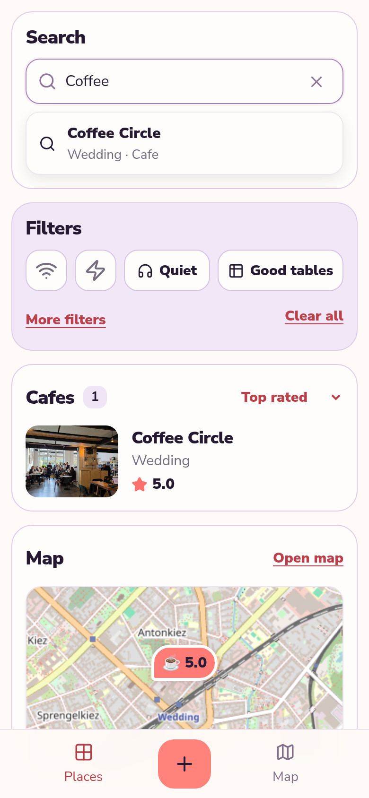
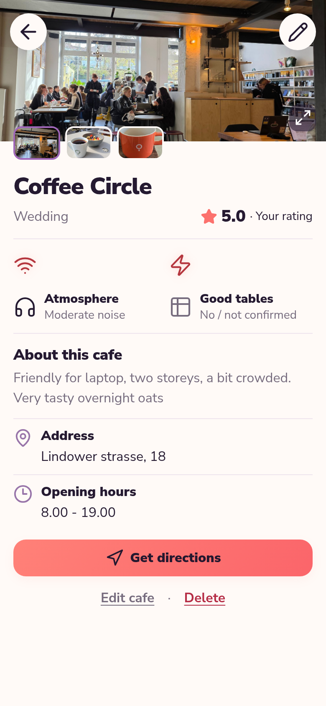
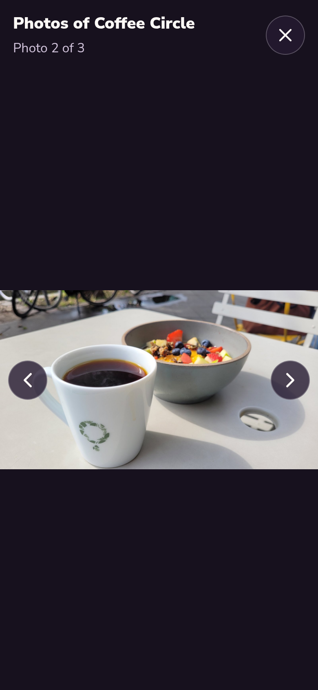

# Cafe Berlin

Find a cafe in Berlin where you can settle in with your laptop. Browse your
collection, check the work essentials, explore the map, and save a new favorite
directly from your phone.

Built for mobile, with an English interface, an installable web app, and an
Android app powered by the same codebase.

## Screenshots

| Search and filters | Cafe details | Full-screen photos |
| :---: | :---: | :---: |
|  |  |  |

Screenshots captured from the running mobile web app using the real cafe
collection and uploaded photos. Shown here: Coffee Circle in Wedding.

## Features

- **Search and filter:** search by cafe name, district, or address, with suggestions
  as you type. Filter by Wi-Fi, outlets, quiet atmosphere, good tables, district,
  and minimum rating. Sort by rating, name, or date added.
- **Explore Berlin:** browse cafe markers, search Berlin addresses with dropdown
  suggestions, and open directions in Google Maps.
- **Save useful details:** descriptions, addresses, websites, photos, and opening
  hours. Set one weekday time range using hour and minute selectors.
- **Manage your collection:** add, edit, and delete cafes from your phone. Upload
  up to six photos and rate each place from 1 to 5 in steps of 0.1. Deleting a
  cafe requires a separate confirmation.
- **Browse photos:** tap a photo to open it full screen, then swipe or use the
  arrows to browse.
- **Use offline:** the PWA keeps the app shell and last loaded collection.
  Previously viewed photos may also be cached. Editing, uploads, address search,
  and loading map tiles require an internet connection.

Wi-Fi and outlets appear as icons without visible labels in cafe details:
coral when available, grey and crossed out when absent or unconfirmed. Good
tables is a separate editable amenity and filter.

There is no sign-in, account system, or role management. Anyone using the app
can read, add, edit, and delete cafes and photos. There are no user reviews or
comments. Demo cards are available separately and never written to the database.

## Tech stack

| Layer | Technology |
| --- | --- |
| Interface | React, TypeScript, Vite |
| Styling and components | Tailwind CSS, shadcn/ui, Radix UI, Lucide icons |
| Maps | Leaflet, React Leaflet, OpenStreetMap |
| Address suggestions | Photon for Berlin addresses |
| Data and photos | Supabase PostgreSQL, Storage, Data API |
| Offline web app | vite-plugin-pwa |
| Android | Capacitor |
| Hosting configuration | Cloudflare Pages |

Maps and address search use OpenStreetMap-based services without Google Cloud
billing or a Google Maps API key. Directions open an external Google Maps link.
For heavier address-search usage, the Photon endpoint can be configured.

## Run locally

Requires **Node.js 22 or newer** and **npm**.

1. Clone the repository and install dependencies:

   ```sh
   git clone https://github.com/AnastasiaMamontova/LaptopFriendlyCafe.git
   cd LaptopFriendlyCafe
   npm ci
   ```

2. Configure a Supabase project using the [backend instructions](supabase/README.md).
   Apply the SQL migrations in filename order, including the Good tables
   migration. For an existing configured project, use its public connection
   settings.

3. Copy `.env.example` to `.env.local`:

   ```sh
   cp .env.example .env.local
   ```

   Set these values in `.env.local`:

   ```dotenv
   VITE_SUPABASE_URL=https://YOUR_PROJECT_REF.supabase.co
   VITE_SUPABASE_ANON_KEY=YOUR_PUBLIC_ANON_KEY
   ```

4. Start the app:

   ```sh
   npm run dev
   ```

   Open **http://localhost:5173**.

The project URL and public anon key are included in browser and Android builds.
Keep the Supabase management token and any service-role key outside client
configuration and Git. `.env.local` is ignored by Git.

For automated backend setup, supply `SUPABASE_PROJECT_ID` and
`SUPABASE_ACCESS_TOKEN` through the environment and run `npm run setup:backend`.
The script applies migrations and writes only public client settings to
`.env.local`. See the [backend guide](supabase/README.md) for access policies and
existing-database compatibility.

## Commands

| Command | Purpose |
| --- | --- |
| `npm run dev` | Start the local development server |
| `npm test` | Run Playwright checks for mobile and desktop |
| `npm run build` | Check TypeScript and create the production web/PWA build in `dist/` |
| `npm run preview` | Preview the production build locally |
| `npm run android:sync` | Build the web app and sync it to the Android project |
| `npm run android:build` | Build a development-signed Android APK |
| `npm run icons:generate` | Generate browser, PWA, and Android icons |

Playwright tests intercept backend requests and do not modify the live database.
They cover search, combined filters, maps, cafe editing, photos, offline data,
confirmation dialogs, and Android Back behavior through a simulated bridge.
The test configuration detects `/usr/bin/chromium` when available; otherwise
install Playwright Chromium or set `PLAYWRIGHT_CHROMIUM_EXECUTABLE_PATH`.
See [verification details](docs/VERIFICATION.md) for the checks performed and
their limits.

## Android and PWA

The Android app bundles the web interface and connects directly to Supabase;
a deployed website is not required. It supports Android 6.0 or newer with a
modern Android System WebView. System Back closes the current photo or dialog,
returns through the app, and asks before exiting from the home collection.

Building requires JDK 21 and the Android SDK in addition to Node.js. Follow the
[Android build guide](scripts/android-README.md). The APK is written to
`downloads/cafe-berlin-debug.apk`; generated APKs and signing keys are excluded
from Git. Keep the signing key to install future builds as updates.

The last verified APK is **1.0.6**. The newer Good tables and Android Back changes
are in the source code and require a new APK build to reach installed devices.

When hosted over HTTPS, the web app can also be installed from the browser's
**Add to Home screen** menu. There is no in-app install button or install prompt.

## Web deployment

Cloudflare Pages configuration is prepared; automatic deployment is not configured.

- **Build command:** `npm run build`
- **Output directory:** `dist`
- **Node.js:** 22 or newer
- **Environment variables:** `VITE_SUPABASE_URL` and `VITE_SUPABASE_ANON_KEY`

Client environment values are embedded at build time. Rebuild the web app or APK
after changing them. The frontend does not need a Supabase management token or
service-role key.

## Documentation

| Guide | Contents |
| --- | --- |
| [Backend setup](supabase/README.md) | Database, Storage, migrations, and public access policies |
| [Home layout](docs/HOME_LAYOUT.md) | Search, filters, cafe list, and map sections |
| [Work essentials](docs/WORK_ESSENTIALS.md) | Good tables, availability icons, and data compatibility |
| [Opening hours](docs/OPENING_HOURS.md) | Weekday time selectors and existing schedules |
| [Berlin address search](docs/ADDRESS_SEARCH.md) | Address suggestions and provider configuration |
| [Cafe details](docs/CAFE_DETAILS.md) | Compact details and deletion confirmation |
| [Android navigation](docs/ANDROID_NAVIGATION.md) | System Back handling and exit confirmation |
| [Android builds](scripts/android-README.md) | Build tools, signing, and installation |
| [Branding](docs/BRANDING.md) | Cappuccino-cat icon assets |
| [Verification](docs/VERIFICATION.md) | Test results and build checks |

Built-in demo photos are from Unsplash:
[coffee](https://images.unsplash.com/photo-1442512595331-e89e73853f31),
[cafe](https://images.unsplash.com/photo-1501339847302-ac426a4a7cbb),
[interior](https://images.unsplash.com/photo-1554118811-1e0d58224f24).
